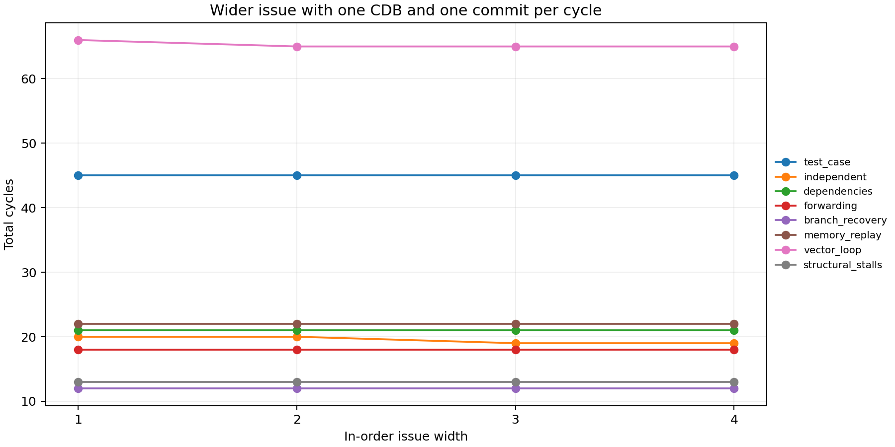

# Tomasulo multiple-issue implementation

## What I changed

I added issue widths 1 through 4. Issue is still in program order, and a bundle
stops when the next instruction cannot get a ROB entry, reservation-station
slot, or load/store-queue slot. Sources are read before the destination is
renamed, so instructions in the same bundle see the correct earlier RAT
updates. This handles RAW, WAR, and WAW dependencies, including dependencies
between instructions issued in one bundle. R0 is kept permanently equal to
zero.

The original Qing (2017) files are still in `starter/`. The active program uses
the new engine in `code/simulator.py`. I did not try to patch the old issue
routine with a loop because several parts of the original implementation made
multiple issue unreliable: initialization was hardcoded, some namedtuple data
was mutated incorrectly, WB could update an old rename, stores were not always
held until the ROB head, EX could advance twice in one cycle, and branches were
serialized instead of using speculative recovery.

The new implementation uses mutable dataclasses, monotonic ROB tags, an
explicit result queue, tag-based operand wakeup, and in-order retirement. I
also added parsing for the hardware settings, initial registers and memory,
comments, commas, and case-insensitive instructions. The assignment opcodes,
including `Beq` and `Bne`, are supported. Functional-unit counts, reservation
station counts, ROB size, EX latency, and memory latency all come from the
input file.

## Processor model and timing

The only setting changed between issue-width runs is the issue width. The
simulator keeps the assignment's one CDB, one commit per cycle, one shared
non-pipelined memory port, unpipelined integer units and address generators,
and pipelined FP add and multiply units. Each FP unit can accept one new
operation per cycle. The configured load/store-unit count controls address
generators; those generators still share one memory port.

An instruction starts EX after its issue cycle. A dependent instruction can
start EX after the producer's WB cycle. Loads enter MEM after address EX and
enter WB after MEM. EX and MEM ranges are inclusive. Completed results wait in
a queue, with the earliest completion and then ROB age used to choose the next
result for the single CDB. Commit happens after WB, except that branches can
commit after resolution. Reservation-station slots are released when EX
starts, while load/store-queue slots are released after load MEM or store
commit. Capacities are checked at the start of the cycle, so a slot freed in a
cycle is available for issue in the next cycle.

Stores change memory only when they reach the ROB head. They use the memory
port for the configured latency and retire on the last memory cycle. Loads
forward from the youngest older matching store, waiting if that store's data
is not ready. A load can begin while an older store address is unresolved. If
that address later conflicts with the load, the load and all younger
instructions are replayed. The same memory selection path is used for
forwarding, so forwarding does not start a second memory operation in the
same cycle.

Branches use an eight-entry direct-mapped BTB. The index uses the lowest three
word-PC bits, and each entry stores a PC tag, taken bit, and target. Cold
branches predict not taken. The prediction affects same-bundle fetch, and EX
resolution updates the BTB. A misprediction removes younger ROB, reservation
station, LSQ, execution, memory, and pending-WB work. The RAT is then rebuilt
from the surviving ROB entries. A branch resolved in cycle `n` blocks cycle
`n+1` and resumes correct fetching in cycle `n+2`. Invalid load addresses are
checked at retirement, so an invalid wrong-path load can be squashed first.

## Fix to the supplied input

The starter input has `Bne R1 R0 -12`. The old code treated the immediate as a
byte offset, while the assignment uses:

```text
target = PC + 4 + (offset << 2)
```

The runnable `code/test_case.txt` therefore uses `-3` so that it keeps the
original control flow. This branch returns to the integer pointer updates,
not to the beginning of the memory loop. The original input is preserved in
`starter/test_case.txt`.

For comparison, `tests/vector_loop.in` uses `-8`. That version runs the whole
three-iteration load/multiply/add/store loop. Keeping both cases made it easier
to check the branch behavior instead of silently changing the expected result.

## Benchmarks

Every case was run at widths 1, 2, 3, and 4. Final registers, nonzero memory,
and committed instruction counts were compared with a separate sequential
interpreter. Stage histories and final states are stored in
`results/<case>_width<width>.txt` and `.json`; the JSON files also include
wrong-path instructions.

| Case | Width 1 | Width 2 | Width 3 | Width 4 | Speedup at 4 |
|---|---:|---:|---:|---:|---:|
| test_case | 45 | 45 | 45 | 45 | 1.000x |
| independent | 20 | 20 | 19 | 19 | 1.053x |
| dependencies | 21 | 21 | 21 | 21 | 1.000x |
| forwarding | 18 | 18 | 18 | 18 | 1.000x |
| branch_recovery | 12 | 12 | 12 | 12 | 1.000x |
| memory_replay | 22 | 22 | 22 | 22 | 1.000x |
| vector_loop | 66 | 65 | 65 | 65 | 1.015x |
| structural_stalls | 13 | 13 | 13 | 13 | 1.000x |

The supplied configuration uses integer EX=1, FP add EX=4, FP multiply EX=15,
MEM=5, RS counts 4/3/2/5, and ROB=64. `vector_loop` uses the same settings.
The other cases use integer EX=2, FP add EX=3, FP multiply EX=6, MEM=3, eight
stations per unit, and ROB=32. `memory_replay` changes integer EX to 7, while
`structural_stalls` has one integer station and EX=4.

The final-state checks were:

- `test_case`: R1=0, R2=20, F2=1, F4=3, F6=7, F20=2, and Mem[32]=7. Mem[24]=6
  and Mem[28]=5 remain unchanged. Fifteen instructions commit.
- `independent`: F4/F6/F8/F10=5 and F5/F7/F9/F11=6. Twelve instructions commit.
- `dependencies`: F4=4, F5=10, F6=6, R1=7, R2=14, and R0=0. Eight commit.
- `forwarding`: F4=2, F5=3, F6=5, Mem[0]=2, and Mem[4]=3. Six commit.
- `branch_recovery`: R1=7, R2=8, and Mem[0]=0. Wrong-path changes are
  discarded; three instructions commit and one branch mispredicts.
- `memory_replay`: F4=2, F5=4, and Mem[8]=2. Four commit and one load replay
  occurs at each width.
- `vector_loop`: R1=0, R2=20, F2=3, F20=6, Mem[24]=15, Mem[28]=11, and
  Mem[32]=7. Twenty-five commit and two branches mispredict at each width.
- `structural_stalls`: F4=5 and F5=6. The second integer instruction blocks
  the younger FP instruction at issue. Four instructions commit.

The largest speedup is only 1.053x, on `independent`. `vector_loop` improves
from 66 to 65 cycles, while the other examples do not change total cycle
count. This makes sense for this model: the single CDB and commit path remain
bottlenecks, and several tests are limited by dependencies, long FP latencies,
or memory serialization. Multiple issue is happening, but it cannot remove
those limits.



## Correctness checks

The test suite contains 16 tests. It covers same-bundle RAW/WAR/WAW behavior,
store forwarding, replay after a late store address, branches and loops, BTB
index conflicts, RAT restoration, cancellation of wrong-path work, wrong-path
stores and invalid loads, n+2 branch recovery, head-of-line stalls, ROB and
LSQ backpressure, the single memory port, integer and FP timing, multiple
functional units, parser validation, issue-width validation, and R0.

One test also generates 25 seeded random programs and runs them at all four
widths, for 100 comparisons with the sequential interpreter. Additional stage
checks verify the single-CDB rule, retirement order, EX latency, issue width,
and stage boundaries. The 32 saved benchmark runs (eight cases at four
widths) also match the interpreter.

## Limitations and attribution

Arithmetic uses Python integers and floats. The simulator does not model
bit-level overflow or single-precision IEEE-754 rounding. Memory is represented
by word values keyed by their byte starting address, matching the starter;
overlapping unaligned words are not modeled as shared bytes. Address checks
allow four-byte words starting at addresses 0 through 252 in the 256-byte
memory.

Dynamic instruction history is kept for the reports, so very long programs
use more host memory. `--max-cycles` stops runaway programs. The tests cover
the implemented behavior, but they do not prove that every possible program
is correct.

The implementation is based on the supplied Qing 2017 code and the assignment
requirements. The sample Tomasulo report was used only as a reference for
report organization; its limited branch support and in-order execution were
not copied. The scheduler here remains out of order.

## Reproduction

From the project directory, run:

```sh
python code/main.py
python tests/test_simulator.py
python run_benchmarks.py
python code/main.py tests/vector_loop.in --issue-width 4
```

Python 3.10+ and the standard library are sufficient. See `README.md` for the
shorter setup instructions.
